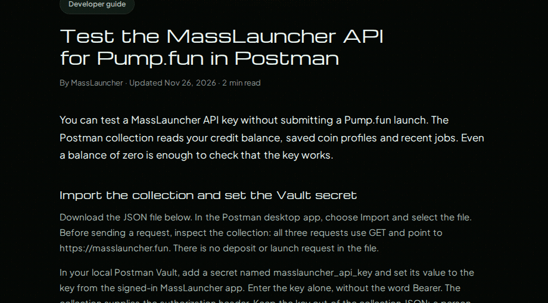

# How to mass launch on Pump.fun: web, Telegram or API

Want five separate Solana tokens from one set of artwork and links? Save a profile, request five launches, then keep the mint address from each successful row. If you want five wallets to hold **one** token, that’s a transfer, not five launches.

### [Open MassLauncher →](https://masslauncher.fun/?utm_source=github&utm_medium=referral&utm_campaign=masslauncher_api&utm_content=quickstart) · [Use Telegram →](https://t.me/MassLauncherBot?start=src_github_quickstart)

**Launch five Pump.fun coins through the API:** Send your saved profile’s index and `quantity: 5` to `POST /api/v1/launches`. That’s one API request, not one blockchain transaction. The response gives you a job ID to check the outcome of each coin. [Read the batch launch API guide](https://masslauncher.fun/blog/pump-fun-launch-api) · [Get an API key](https://masslauncher.fun/app/api-keys?utm_source=github&utm_medium=referral&utm_campaign=masslauncher_api&utm_content=quickstart).

Want to check your key before spending credits? [Open the Postman walkthrough](https://masslauncher.fun/blog/pump-fun-api-postman?utm_source=github&utm_medium=referral&utm_campaign=masslauncher_api&utm_content=quickstart) or [download the collection](examples/masslauncher-readonly.postman_collection.json). Its three requests only read account data; none submits a launch.

Using the service by hand? [Follow the first-order walkthrough](docs/getting-started.md). Integrating a backend? [See how to handle pending results and timeouts](https://masslauncher.fun/blog/pump-fun-api-job-results?utm_source=github&utm_medium=referral&utm_campaign=masslauncher_api&utm_content=quickstart) before enabling live requests.

## Try the price before you sign in

Buying **25 standard credits together costs 0.475 SOL** before extras. You can spend them in one web order or spread them across smaller orders. This image shows that exact selection on the public calculator; your account quote is the one to use when paying.

## Pick the guide you need

| Question | Guide |
| --- | --- |
| Where do I enter the name, image and links? | [From sign-in to your first result](docs/getting-started.md) |
| Which price applies to my purchase? | [Read your credit quote](docs/pricing.md) |
| I got a job ID or a pending row. Did my coin launch? | [Read a batch result](docs/how-it-works.md) |
| Can I integrate this into my own app? | [API quickstart: check a balance before submitting a job](https://masslauncher.fun/blog/pump-fun-launch-api) |
| Do I need the Pump SDK, PumpPortal or MassLauncher? | [Which Pump.fun API fits the job?](https://masslauncher.fun/blog/pump-fun-api) |
| How does another batch launcher handle the same order? | [Eight worked comparisons](https://masslauncher.fun/blog#batch-launcher-comparisons) |

The web app takes up to **25** coins per order; the Telegram bot takes up to **100**. The service checks each creation separately. A successful launch does not guarantee that another site lists it or that anyone sees or trades it.

This is documentation for a hosted service, not an installable launcher or an official Pump.fun SDK. [Product overview](https://github.com/Mass-Launcher/MassLauncher) · [All public guides](https://masslauncher.fun/blog) · [Security contact](SECURITY.md)
